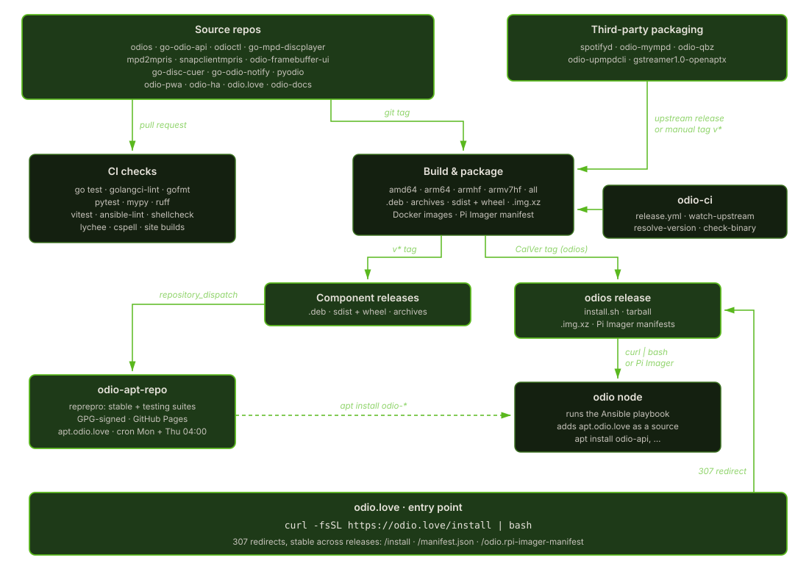
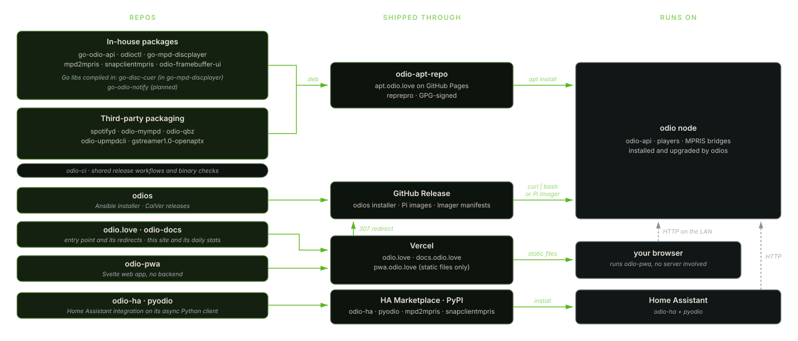

import { Aside } from '@astrojs/starlight/components';

The whole pipeline runs on [GitHub Actions](https://github.com/features/actions): a `v*` tag on a component repo ends as a signed `.deb` on [apt.odio.love](https://apt.odio.love), a CalVer tag on odios ends as the installer and the Pi images. Each section links the workflow files, so you can jump straight to the part you care about.

<figure>

</figure>

## CI on every pull request

Nothing merges to `main` without the relevant checks running green.

| Repo | Checks | Worth knowing |
|---|---|---|
| [odios](https://github.com/b0bbywan/odios/blob/main/.github/workflows/checks.yml) | `ansible-lint`, `shellcheck`, Python `unittest`, [ruff](https://docs.astral.sh/ruff/) + [mypy](https://mypy.readthedocs.io/) | Role-drift check: a PR whose touched files don't match a role-version bump fails |
| [go-odio-api](https://github.com/b0bbywan/go-odio-api/blob/main/.github/workflows/ci.yml) | `go test -race`, coverage gate (15%, on [Codecov](https://about.codecov.io/)), [golangci-lint](https://golangci-lint.run/), `gofmt`, `go mod tidy` drift | Compiles the embedded Tailwind CSS via [Task](https://taskfile.dev/) first, since the binary ships the UI |
| [odioctl](https://github.com/b0bbywan/odioctl/blob/main/.github/workflows/build.yml) | `gofmt`, golangci-lint, `go test -race` | Regenerates the sudoers fragment from the DAC catalog and fails on drift, then `visudo -c`. The built `.deb` is installed and smoke-tested in a container |
| [go-mpd-discplayer](https://github.com/b0bbywan/go-mpd-discplayer/blob/master/.github/workflows/lint.yml) | `gofmt`, golangci-lint, `go test -race` | Installs the cgo headers it links against (ALSA, libdiscid, libudev) first. The [build](https://github.com/b0bbywan/go-mpd-discplayer/blob/master/.github/workflows/build.yml) of all four arches also runs on every PR |
| [mpd2mpris](https://github.com/b0bbywan/mpd2mpris/blob/master/.github/workflows/build.yml), [snapclientmpris](https://github.com/b0bbywan/snapclientmpris/blob/master/.github/workflows/build.yml) | ruff, mypy, pytest | CI calls the same `Makefile` targets as local dev. On a `v*` tag, `make check-tag` fails fast when the tag and `__init__.py` disagree |
| [go-disc-cuer](https://github.com/b0bbywan/go-disc-cuer) | Build, test, golangci-lint | |
| [go-odio-notify](https://github.com/b0bbywan/go-odio-notify/blob/main/.github/workflows/ci.yml) | Same Go checks | Runs on Go 1.24 and 1.25 |
| [pyodio](https://github.com/b0bbywan/pyodio/blob/main/.github/workflows/build.yml) | ruff, mypy, pytest on Python 3.12 to 3.14, under [uv](https://docs.astral.sh/uv/) | On a `v*` tag, checks the tag matches the declared version |
| [odio-pwa](https://github.com/b0bbywan/odio-pwa/blob/main/.github/workflows/ci.yml) | `svelte-check`, [Vitest](https://vitest.dev/) | |
| [odio-ha](https://github.com/b0bbywan/odio-ha/blob/master/.github/workflows/ci.yml) | ruff, mypy, pytest | [HACS](https://hacs.xyz/) and `hassfest` validations run on every PR [and daily](https://github.com/b0bbywan/odio-ha/blob/master/.github/workflows/validate.yml), so a manifest rule change surfaces here before it reaches a Home Assistant log |
| [odio-apt-repo](https://github.com/b0bbywan/odio-apt-repo/blob/master/.github/workflows/pr-validate.yml) | `bash -n`, `shellcheck`, `--help` smoke test of every subcommand, README render | [Builds the full signed repository](https://github.com/b0bbywan/odio-apt-repo/blob/master/.github/workflows/pr-build.yml) as a plain artifact, so the `reprepro` output can be inspected without deploying |
| [odio-upmpdcli](https://github.com/b0bbywan/odio-upmpdcli/blob/main/.github/workflows/ci.yml) | `shellcheck` | Runs the upstream sync read-only, so the PR shows what the next watch run would tag |
| [gstreamer1.0-openaptx](https://github.com/b0bbywan/gstreamer1.0-openaptx/blob/main/.github/workflows/build.yml) | Full build and `check-binary` on every branch push | Publishes nothing until a tag |
| [odio.love](https://github.com/b0bbywan/odio.love/blob/main/.github/workflows/ci.yml) | ESLint, `astro check`, Vitest, Astro build | `csp:check` fails when the CSP header in `vercel.json` drifts from the build, `check:obfuscation` when the contact address or Discord invite ends up literal. Every declared redirect must answer 200 ([odio-docs#33](https://github.com/b0bbywan/odio-docs/issues/33)) |
| [odio-docs](https://github.com/b0bbywan/odio-docs/blob/main/.github/workflows/lint.yml) | Astro build, [lychee](https://github.com/lycheeverse/lychee-action), [cspell](https://cspell.org/) | |

## Shared CI plumbing

[odio-ci](https://github.com/b0bbywan/odio-ci) holds what the packaging repos would otherwise repeat. The build itself stays in each repo, because the builds genuinely differ.

| Piece | What it does | Used by |
|---|---|---|
| [`release.yml`](https://github.com/b0bbywan/odio-ci/blob/main/.github/workflows/release.yml) | Collects the per-arch artifacts, fails when no `.deb` came out, derives the prerelease flag from the tag, creates the Release and dispatches odio-apt-repo | odioctl, odio-framebuffer-ui, odio-mympd, odio-qbz, odio-upmpdcli, gstreamer1.0-openaptx |
| [`watch-upstream.yml`](https://github.com/b0bbywan/odio-ci/blob/main/.github/workflows/watch-upstream.yml) | Resolves an upstream project's latest GitHub release and pushes a matching tag when it's new. The cron stays in the caller, a reusable workflow has no trigger of its own | odio-mympd, odio-qbz |
| [`resolve-version`](https://github.com/b0bbywan/odio-ci/tree/main/actions/resolve-version) | Turns the trigger into an upstream tag and a Debian version | odio-mympd |
| [`check-binary`](https://github.com/b0bbywan/odio-ci/tree/main/actions/check-binary) | Gates provable from the ELF alone, no board or QEMU needed: machine matches the package arch, ARM baseline is what it claims (an ARMv7 build `SIGILL`s on a Pi 1 or Zero), glibc floor no higher than Raspberry Pi OS, `NEEDED` printed to cross-check `Depends` | odio-framebuffer-ui, odio-mympd, gstreamer1.0-openaptx |

A release candidate tag like `v2.0.2-rc1` builds upstream `v2.0.2` and versions the package `2.0.2~rc1`, with a tilde: Debian sorts `~` below the final release, while a dash would sort above it and apt would never upgrade off the RC.

Callers pin an exact `vX.Y.Z`. GitHub's immutable releases freeze a tag once released, so there is no floating `v1` to move forward; Dependabot bumps the pins instead.

## The component release chain

Eleven repos feed `.deb` into [apt.odio.love](https://apt.odio.love):

| Repo | Build | Arches |
|---|---|---|
| [go-odio-api](https://github.com/b0bbywan/go-odio-api) | Go cross-compile, packed with [nfpm](https://nfpm.goreleaser.com/), plus `.rpm` and a multi-arch GHCR image | amd64, arm64, armhf, armv7hf |
| [odioctl](https://github.com/b0bbywan/odioctl) | Go, smoke-tested in a container, plus bare binaries | amd64, arm64, armhf |
| [go-mpd-discplayer](https://github.com/b0bbywan/go-mpd-discplayer) | Go with cgo, ARM builds inside Raspberry Pi OS images under QEMU | amd64, arm64, armhf, armv7hf |
| [mpd2mpris](https://github.com/b0bbywan/mpd2mpris), [snapclientmpris](https://github.com/b0bbywan/snapclientmpris) | Pure Python, built once in a `debian:trixie` container | all |
| [odio-framebuffer-ui](https://github.com/b0bbywan/odio-framebuffer-ui) | `dpkg-buildpackage` in per-arch `debian:trixie` builder images, `lintian` | amd64, arm64 |
| [spotifyd](https://github.com/b0bbywan/spotifyd) | Rust fork, in a builder image | amd64, arm64, armhf |
| [odio-mympd](https://github.com/b0bbywan/odio-mympd) | Upstream myMPD in per-arch builder images rebuilt [monthly](https://github.com/b0bbywan/odio-mympd/blob/main/.github/workflows/build-images.yml) | amd64, arm64, armhf |
| [odio-qbz](https://github.com/b0bbywan/odio-qbz) | Upstream qbz tag plus the patches in `patches/`, `qbzd` daemon only, ELF gates in the builder | amd64, arm64, armhf |
| [odio-upmpdcli](https://github.com/b0bbywan/odio-upmpdcli) | No build: upstream Debian packages republished unchanged | amd64, arm64, armhf, all |
| [gstreamer1.0-openaptx](https://github.com/b0bbywan/gstreamer1.0-openaptx) | Debian's `gst-plugins-bad1.0` source, only `ext/openaptx/` compiled | amd64, arm64, armhf |

The flow is the same for all of them:

1. A `v*` tag is pushed, by hand or by an upstream watcher.
2. `build.yml` produces the `.deb`.
3. A GitHub Release is created with every `.deb` attached.
4. A `repository_dispatch` of type `release-published`, signed with `APT_REPO_TOKEN`, tells [odio-apt-repo](https://github.com/b0bbywan/odio-apt-repo) to rebuild.

Every `armhf` package targets ARMv6, so it runs on a Pi 1 or Zero; go-odio-api and go-mpd-discplayer add an ARMv7 build as `armv7hf`. Where armhf is compiled natively rather than cross-compiled, it runs under QEMU, since GitHub's ARM runners can't execute 32-bit ARM code. For odio-qbz that takes hours where amd64 and arm64 take minutes, hence a longer timeout and a build cache.

### Tracking upstream

Four repos package someone else's project. They vendor no source, only CI.

| Repo | Upstream | New version detected by |
|---|---|---|
| odio-mympd | [jcorporation/myMPD](https://github.com/jcorporation/myMPD) releases | odio-ci's watcher, daily at 06:17 UTC |
| odio-qbz | [vicrodh/qbz](https://github.com/vicrodh/qbz) releases | odio-ci's watcher, daily at 06:23 UTC |
| odio-upmpdcli | The upstream APT repositories on [lesbonscomptes.com](https://www.lesbonscomptes.com/upmpdcli/) | Its [own watcher](https://github.com/b0bbywan/odio-upmpdcli/blob/main/.github/workflows/watch-upstream.yml), daily at 06:41 UTC, comparing the packages with the latest release |
| gstreamer1.0-openaptx | `gst-plugins-bad1.0` in Debian trixie | Tagged by hand, following the GStreamer version trixie ships |

odio-ci's watcher pushes its tag with [`RELEASE_PAT`](#secrets-and-trust). odio-upmpdcli does without: it pushes the tag with `GITHUB_TOKEN`, then starts `build.yml` on it with a `workflow_dispatch`, which that token is allowed to trigger.

The `b0bbywan/spotifyd` fork carries CI-only commits, but the source lives in the repo, so it keeps a build workflow of its own rather than this shape.

### The apt repository rebuild

[odio-apt-repo](https://github.com/b0bbywan/odio-apt-repo/blob/master/.github/workflows/update-repo.yml) receives the dispatch and rebuilds from scratch:

- `gh release list` resolves the latest stable and latest prerelease of every repo above. A manual `workflow_dispatch` accepts a version override per repo.
- Only the `.deb` a previous run didn't fetch are downloaded: `debs/` is cached on the resolved versions, so a rebuild that finds nothing new downloads nothing and the download counters stay honest.
- [`reprepro`](https://salsa.debian.org/debian/reprepro) assembles two suites, `stable` and `testing`, across `amd64`, `arm64`, `armhf`, and `armv7hf`.
- The tree is GPG-signed, written with a `CNAME` for `apt.odio.love`, and deployed to [GitHub Pages](https://pages.github.com/).

A cron reruns it every Monday and Thursday at 04:00 UTC, so a missed dispatch never leaves the repo stale for long, and the `.deb` cache stays inside the seven days after which GitHub evicts it.

## odios releases

[odios](https://github.com/b0bbywan/odios) ships the installer, not `.deb` packages. On a CalVer tag like `2026.4.1`, [`release.yml`](https://github.com/b0bbywan/odios/blob/main/.github/workflows/release.yml) runs:

| Stage | What it does |
|---|---|
| Gate | Reuses [`checks.yml`](https://github.com/b0bbywan/odios/blob/main/.github/workflows/checks.yml), so a red lint or test never produces a release |
| Package | Vendors `ansible-core` as pure Python and packs `odio-<version>.tar.gz` with `install.sh` and `manifest.json` |
| Playbook test | Full run on `ubuntu-latest` with an idempotence rerun, then a single pass on native ARM64 and on ARM/v7 + ARM/v6 under [QEMU](https://www.qemu.org/) (ARM/v6 marked experimental) |
| Install test | `test.sh` in `install` and `install-root` modes against the just-published pre-release, through the real `curl` one-liner |
| Upgrade test | A matrix over baselines of every supported `state.json` generation, detailed below |
| Images | Raspberry Pi images (`odio-*.img.xz`) for armhf and arm64 |
| Imager manifest | A combined `odio.rpi-imager-manifest` for [Raspberry Pi Imager](https://www.raspberrypi.com/software/). Pre-releases also get one per arch, so a PR can be tested in Imager as soon as one arch is built |

The upgrade matrix enters through every path a node can take: the last published `odio_upgrade.py` over `curl` (the migration off a pre-[odioctl](/operations/settings/) baseline), `odioctl upgrade apply`, `odio-upgrade.service` via `systemctl --user` (which exercises the sudoers switch to the `odioctl` group), and a `--progress` run asserting the `ODIO_PROGRESS` events. Two more entries cover an upgrade triggered by a user other than the target user, and baselines installed without the MPD stack. The baselines live at `ghcr.io/b0bbywan/odios/test-baseline:<tag>-<arch>`: arm64 ones are converted from the published SD images by [`img-to-docker.sh`](https://github.com/b0bbywan/odios/blob/main/scripts/img-to-docker.sh), amd64 ones are layered onto `Dockerfile.test` by [`build-baseline-amd64.sh`](https://github.com/b0bbywan/odios/blob/main/scripts/build-baseline-amd64.sh) so the systemctl path runs under real systemd-logind without QEMU.

Pull requests run the same matrix against a `pr-<N>` pre-release, so the install path you'd take is tested before merge, not only before release.

<figure>

</figure>

Everything lands on a single [GitHub Release](https://github.com/b0bbywan/odios/releases). `odio.love/install`, `/manifest.json`, and `/odio.rpi-imager-manifest` are 307 redirects from the [odio.love](https://github.com/b0bbywan/odio.love) site to `releases/latest/download/<asset>`, so `curl -fsSL https://odio.love/install | bash` never changes. To pin a version, call the GitHub URL with the tag, as shown in [Upgrade](/operations/upgrade/).

## PWA, Home Assistant, and PyPI

- [odio-pwa](https://github.com/b0bbywan/odio-pwa)'s [`release.yml`](https://github.com/b0bbywan/odio-pwa/blob/main/.github/workflows/release.yml) zips the built `dist/` as `odio-pwa-<version>.zip` and builds the Docker image for amd64 and arm64 on native runners, merged into one multi-arch tag on `ghcr.io/b0bbywan/odio-pwa`. Only stable releases move `:latest`.
- [odio-ha](https://github.com/b0bbywan/odio-ha)'s [release workflow](https://github.com/b0bbywan/odio-ha/blob/master/.github/workflows/release.yml) waits for CI to pass on the tag, via `workflow_run`, before creating the release. Prereleases are detected from the tag suffix (`-alpha`, `-beta`, `-rc`).
- [mpd2mpris](https://pypi.org/project/mpd2mpris/), [snapclientmpris](https://pypi.org/project/snapclientmpris/), and [pyodio](https://pypi.org/project/pyodio/) publish their sdist and wheel through PyPI [trusted publishing](https://docs.pypi.org/trusted-publishers/). Every tag goes to [TestPyPI](https://test.pypi.org/), only final releases continue to PyPI.

## Secrets and trust

| Secret | Held by | Used for |
|---|---|---|
| `APT_REPO_TOKEN` | The repos publishing to apt.odio.love | The cross-repo dispatch. A personal access token scoped to `b0bbywan/odio-apt-repo`, so nothing else can trigger the rebuild from outside |
| `GPG_PRIVATE_KEY` | odio-apt-repo only | Signing the `Release` files, which `apt` verifies on every node before installing anything |
| `RELEASE_PAT` | odio-mympd, odio-qbz | Pushing the tag for a new upstream release, since a tag pushed with the default token starts no workflow |

PyPI needs no secret: the publishing job authenticates with a short-lived OIDC token bound to the repository and workflow, so there is nothing to store or rotate. Everything else (GitHub Releases, cross-repo asset downloads, Pages deploys) runs on the default `GITHUB_TOKEN`, scoped to each workflow run.

## Manual verification on hardware

On top of the automated matrix, two Raspberry Pis cover the manual checks:

- A **Pi 3B+** (arm64), a dedicated test rig, validates each PR: the [`pr-N` pre-release](#odios-releases) is run both as an upgrade from the previous release and as a reflash from the PR's image.
- A **Pi B+** (armv6), the maintainer's production node, takes every newly tagged stable as an upgrade from the previous one, after the release ships. A full playbook run takes around two hours there, so it stays off the mid-cycle loop.

Transcripts of these sessions, `PLAY RECAP` outputs with `failed=0`, and the upgrade paths walked are public in the [upgrade-system RFC](https://github.com/b0bbywan/odios/discussions/34), along with the hardware runs done while the upgrade system was being built.

## Repository overview

The graph shows how the repositories connect, at build time (Go modules, `.deb` ingest, archives fetched at install) and at runtime (clients calling the API over HTTP). Green solid edges are build, install, or deploy; grey dashed edges are runtime. The bottom row is hosting: GitHub Pages for `apt.odio.love` and `stats.odio.love`, Vercel for the rest.

<figure>

</figure>

| Repo | Role in the ecosystem |
|---|---|
| [odios](https://github.com/b0bbywan/odios) | Orchestrator. Adds `apt.odio.love` as a source, installs `odio-api`, `odioctl`, `mpd-discplayer`, `spotifyd`, `upmpdcli`, `mpd2mpris`, `mympd`, `qbzd`, `snapclientmpris`, and optionally `odio-kiosk` |
| [go-odio-api](https://github.com/b0bbywan/go-odio-api) | Core REST API, on every node via `apt install odio-api`. Called over HTTP by `odio-pwa` and `odio-ha` |
| [odioctl](https://github.com/b0bbywan/odioctl) | Node control: upgrades, components, DAC overlay, and the [settings page](/operations/settings/) |
| [go-mpd-discplayer](https://github.com/b0bbywan/go-mpd-discplayer) | CD / USB auto-play daemon (`mpd-discplayer`). Embeds `go-disc-cuer` as a Go module |
| [mpd2mpris](https://github.com/b0bbywan/mpd2mpris) | MPRIS2 bridge for MPD, with [`as_directory`-aware](/disc-player/configuration/#cue-file-storage) cover-art lookup for virtual CUE folders |
| [snapclientmpris](https://github.com/b0bbywan/snapclientmpris) | MPRIS2 bridge for the local Snapcast client, forwarding controls to the snapserver source so pausing one room pauses every listener |
| [odio-framebuffer-ui](https://github.com/b0bbywan/odio-framebuffer-ui) | `odio-kiosk`, a Qt 6 WebEngine browser drawn straight onto the framebuffer, behind the [local screen](/control/local-screen/) |
| [go-disc-cuer](https://github.com/b0bbywan/go-disc-cuer) | CUE sheet + GnuDB / MusicBrainz lookup, compiled into `go-mpd-discplayer` |
| [go-odio-notify](https://github.com/b0bbywan/go-odio-notify) | Shared audio notification lib, released as cross-arch binaries. Planned as Go module dependency for `go-odio-api` and `go-mpd-discplayer` |
| [pyodio](https://github.com/b0bbywan/pyodio) | Async Python client for `odio-api`: live state mirror over SSE, high-level hub, low-level REST client |
| [odio-pwa](https://github.com/b0bbywan/odio-pwa) | Standalone client app, talks to `go-odio-api` over HTTP |
| [odio-ha](https://github.com/b0bbywan/odio-ha) | Home Assistant custom component, talks to `go-odio-api` over HTTP |
| [odio-apt-repo](https://github.com/b0bbywan/odio-apt-repo) | Ingests the `.deb` of every repo in the [release chain](#the-component-release-chain) |
| [odio-ci](https://github.com/b0bbywan/odio-ci) | [Shared CI plumbing](#shared-ci-plumbing) and the pinned base images |
| [spotifyd](https://github.com/b0bbywan/spotifyd) | Fork of [Spotifyd](https://github.com/Spotifyd/spotifyd) carrying the CI, no source changes. Provides Spotify Connect |
| [odio-mympd](https://github.com/b0bbywan/odio-mympd) | Build-only pipeline for [myMPD](https://github.com/jcorporation/myMPD) |
| [odio-qbz](https://github.com/b0bbywan/odio-qbz) | Build-only pipeline for `qbzd`, the headless Qobuz daemon, with the armhf build upstream doesn't ship |
| [odio-upmpdcli](https://github.com/b0bbywan/odio-upmpdcli) | upmpdcli with its libraries and plugins, so odio doesn't depend on a third-party APT repository. Provides the [UPnP/DLNA renderer](/guides/dlna/) |
| [gstreamer1.0-openaptx](https://github.com/b0bbywan/gstreamer1.0-openaptx) | The GStreamer aptX / aptX HD plugin PulseAudio's Bluetooth module encodes through, without the rest of `gst-plugins-bad` |
| [odio.love](https://github.com/b0bbywan/odio.love) | Serves `/install`, `/manifest.json`, `/odio.rpi-imager-manifest` from the latest `odios` GitHub Release |
| [odio-docs](https://github.com/b0bbywan/odio-docs) | This site. A [daily workflow](https://github.com/b0bbywan/odio-docs/blob/main/.github/workflows/stats.yml) also publishes the stats behind the [activity page](/community/activity/) to `stats.odio.love` |

<Aside type="tip">Something in this pipeline could be better? Open an [issue on odio-docs](https://github.com/b0bbywan/odio-docs/issues) or start a [discussion on odios](https://github.com/b0bbywan/odios/discussions).</Aside>

## Acknowledgments

- **The people whose work and thinking have inspired me** through odio's development.
- **Laurent T.**, for the Pi 3B+ used for per-PR testing, which keeps that loop off my production node.
- **[@vascoguita](https://github.com/vascoguita)**, for [raspios-docker](https://github.com/vascoguita/raspios-docker), the per-arch Raspberry Pi OS Docker images that every ARM `.deb` and the upgrade test images are built on top of. Specifically:
  - [go-mpd-discplayer's Dockerfile](https://github.com/b0bbywan/go-mpd-discplayer/blob/master/Dockerfile) cross-builds the CGO `.deb` for arm64/armhf inside `vascoguita/raspios:arm64` and `vascoguita/raspios:armhf` under QEMU.
  - [spotifyd's Dockerfile.builder](https://github.com/b0bbywan/spotifyd/blob/master/.github/Dockerfile.builder) uses the same bases for the `spotifyd-builder` image published to GHCR.
  - [odio-mympd's per-arch builders](https://github.com/b0bbywan/odio-mympd/blob/main/.github/workflows/build-images.yml) are rebuilt monthly on top of the same images.
  - [odios's test image](https://github.com/b0bbywan/odios/blob/main/tests/Dockerfile.test) targets the same bases so the upgrade matrix runs against a Pi-faithful environment, and [`scripts/img-to-docker.sh`](https://github.com/b0bbywan/odios/blob/main/scripts/img-to-docker.sh) derives the upgrade-test baselines following the same approach.
