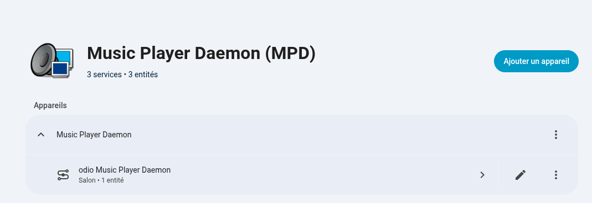
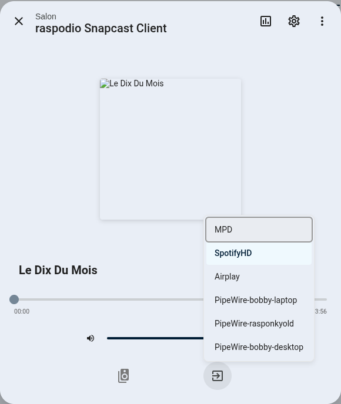

Open **Settings → Devices & services → Odio Remote** and select **Configure** to change the options of a node. The menu offers two pages: **SSE settings** and **Entity mappings**.

## SSE keepalive

How often the node sends a keepalive on the [event stream](/api/events/), in seconds, from 10 to 120. The default, 30 seconds, suits most networks.

odio-ha considers the connection lost when nothing arrives for the interval plus 15 seconds, then reconnects. A shorter interval detects a dead node sooner, a longer one sends less traffic.

## Entity mapping

odio-ha doesn't replace existing Home Assistant integrations. MPD, Snapcast, spotifyd and upmpdcli all have their own dedicated integrations for rich playback control.

A mapping links an odio entity to one of these media players so Home Assistant treats them as one. Three kinds of odio entities can be mapped:

- **Services**, such as `mpd.service` mapped to `media_player.music_player_daemon`. A mapped service gets its own media player.
- **Remote audio clients**, such as a PipeWire tunnel from an HTPC mapped to `media_player.kodi_htpc`.
- **MPRIS players**, to fall back on another media player's controls.

A mapped entity combines:

- Start and stop through systemd, for services.
- Volume and mute through PulseAudio or PipeWire, for the whole node or for one client.
- Everything the mapped media player offers: transport, seek, shuffle, repeat, source, metadata, album art, position.

Without a mapping, a service or client entity only offers volume, mute, and a playing or idle state.

Services can be mapped during the initial setup. Services, remote clients and MPRIS players can all be mapped later from **Configure → Entity mappings**. Check **Delete** next to a mapping to remove it.

## Changing the API URL

If the node's address or port changes, open **Settings → Devices & services → Odio Remote**, and select **Reconfigure** from the node's menu to enter the new API URL. The node keeps its entities and settings.
